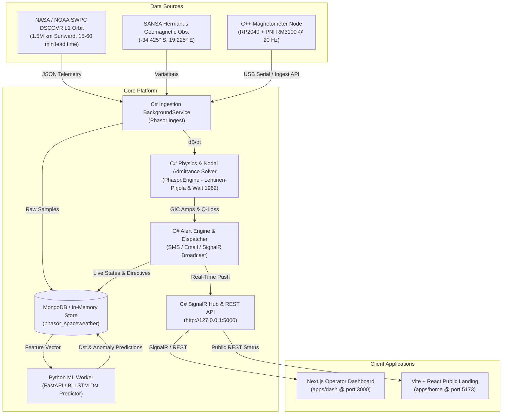

# Phasor — System Design & Architecture Specification
**NASA International Space Apps Challenge 2026**

Real-time space-weather early warning system for African electricity grids.
Live DSCOVR/NOAA solar-wind data $\rightarrow$ geoelectric field estimation for South African geology $\rightarrow$ substation GIC nodal solver $\rightarrow$ actionable alerts and automated grid dispatches.

---

## 1. System Topology & Seams



### Architectural Seams & Rules
1. **Single Writer, Single Public API:** The **C# ASP.NET Core service** is the only writer to the database and the only public API.
2. **Internal ML Worker:** The Python service is an internal worker accessed by the platform for predictive inference and anomaly scoring.
3. **Hardware Sensor Independence:** The C++ Raspberry Pi Pico node functions as an independent ground magnetometer node streaming standard INTERMAGNET-compatible telemetry.
4. **Resilient Fallback:** If any upstream external feed or internal service fails, the platform automatically degrades gracefully into deterministic stochastic physics replay. Judges never see a blank or error screen.

---

## 2. Service Catalog

| Service | Directory | Tech Stack | Port | Role |
| :--- | :--- | :--- | :--- | :--- |
| **Public Homepage** | `apps/home` | Vite, React 18, Tailwind CSS | `5173` | Public story, live risk gauge badge, physics explainer, team background. |
| **Operator Dashboard** | `apps/dash` | Next.js 14, React 18, SignalR | `3000` | SaaS operations center (Monday.com design, dark red theme), 5 core views (`/`, `/alerts`, `/replay`, `/model`, `/hardware`). |
| **API & Physics Core** | `services/api` | C# .NET 10, ASP.NET Core, SignalR | `5000` | Ingestion background worker, Lehtinen-Pirjola GIC nodal admittance solver, Wait 1D MT layer model, alert engine, SMS/Email dispatch. |
| **ML Predictor** | `services/ml` | Python 3.11, FastAPI, PyTorch/NumPy | `5001` | Bi-LSTM ring current ($Dst$) predictor (1-6h ahead) and DSCOVR telemetry anomaly detector. |
| **Hardware Node** | `firmware/` | C++, PlatformIO, Arduino, Wire I2C | Serial | Raspberry Pi Pico RP2040 + PNI RM3100 3-axis magneto-inductive sensor at 20 Hz with discrete Kalman filtering. |
| **Infrastructure** | `infra/` | Docker Compose, MongoDB 7.0 | `27017` | Full-stack orchestration, MongoDB time-series indexes, and historical storm seeders. |

---

## 3. Mathematical & Geophysical Foundations

### 3.1 Faraday Induction & Magnetotelluric Surface Impedance
The time variation of the geomagnetic field $\mathbf{B}$ induces an horizontal geoelectric field $\mathbf{E}$ in the conductive crust and upper mantle:
$$\nabla \times \mathbf{E} = -\frac{\partial \mathbf{B}}{\partial t}$$

Phasor calculates the frequency-domain surface impedance $Z(\omega)$ using Wait's (1962) recurrence relation for an $N$-layer stratified 1D Earth model:
$$Z_m(\omega) = \frac{i\omega\mu_0}{k_m} \coth\left(k_m h_m + \operatorname{artanh}\left(\frac{k_m Z_{m+1}(\omega)}{i\omega\mu_0}\right)\right)$$
where $k_m = \sqrt{i\omega\mu_0\sigma_m}$ is the propagation constant of layer $m$ with electrical conductivity $\sigma_m$ and thickness $h_m$.

### 3.2 South African Geological Conductivities
The system includes calibrated 1D magnetotelluric profiles across 7 distinct South African lithospheric terranes:
1. **Kaapvaal Craton (Highveld):** Ancient Archaean craton, high resistivity ($\rho \sim 3,500\,\Omega\cdot\text{m}$), highest induction hazard.
2. **Karoo Central Basin (Hydra-Beta corridor):** Deep sedimentary cover with conductive dolerite sills ($\rho \sim 250\,\Omega\cdot\text{m}$).
3. **Cape Fold Belt (Southern Coastline):** Marine sedimentary rocks ($\rho \sim 450\,\Omega\cdot\text{m}$).
4. **Bushveld Complex (Limpopo / North):** Highly mineralized igneous intrusion ($\rho \sim 1,200\,\Omega\cdot\text{m}$).
5. **KwaZulu-Natal Coastal Corridor:** Conductive marine sediments ($\rho \sim 120\,\Omega\cdot\text{m}$).
6. **Namaqualand Metamorphic Complex:** Gneissic terrain ($\rho \sim 1,800\,\Omega\cdot\text{m}$).
7. **Eastern Cape Coastal / Drakensberg:** Mixed basaltic and sandstone terrain ($\rho \sim 600\,\Omega\cdot\text{m}$).

### 3.3 Lehtinen-Pirjola (1985) Nodal Admittance Solver
Geomagnetically induced currents (GICs) flow through transformer grounded neutrals and high-voltage transmission lines. The nodal admittance equation is solved across the 13 major Eskom 400 kV and 765 kV substations:
$$\mathbf{I}_{\text{GIC}} = (\mathbf{I} + \mathbf{Y}_n \mathbf{Z}_e)^{-1} \mathbf{J}^e$$
where:
- $\mathbf{Y}_n$ is the network admittance matrix of transmission lines.
- $\mathbf{Z}_e$ is the earthing impedance matrix of substations.
- $\mathbf{J}^e$ is the vector of line-induced electromotive forces (EMF): $V_{ij} = \int_i^j \mathbf{E} \cdot d\mathbf{l} \approx E_x \Delta x_{ij} + E_y \Delta y_{ij}$.
- Ground current conservation is strictly enforced: $\sum_k I_{\text{GIC}, k} = 0$.

### 3.4 Transformer Reactive Power Loss & Thermal Saturation
Quasi-DC GIC flowing into transformer neutrals causes half-cycle core saturation, increasing magnetizing current and reactive power consumption:
$$Q_{\text{loss}} = k \cdot V_{\text{rated}} \cdot |I_{\text{neutral}}|$$
where $k \approx 0.72\,\text{Mvar}/(\text{A}\cdot\text{kV})$ for single-phase shell-form autotransformers (e.g., Hydra 765 kV).

---

## 4. Running the Platform

### Option A: Turnkey Docker Compose (Production / Demo)
```bash
# Build and launch all 5 containers
docker-compose -f infra/docker-compose.yml up --build

# In a separate terminal, seed the database with May 2024 storm data
python infra/seed_data.py
```
Access endpoints:
- Product Dashboard: `http://localhost:3000`
- Public Homepage: `http://localhost:5173`
- C# Backend & SignalR Hub: `http://localhost:5000`
- Python ML Worker: `http://localhost:5001`
- MongoDB: `mongodb://localhost:27017`

### Option B: Local Development
1. **C# Backend:**
   ```bash
   dotnet run --project services/api/Phasor.Api/Phasor.Api.csproj
   ```
2. **Python ML Service:**
   ```bash
   python -m uvicorn services.ml.main:app --port 5001 --host 0.0.0.0
   ```
3. **Next.js Dashboard:**
   ```bash
   cd apps/dash && npm run dev
   ```
4. **Vite Homepage:**
   ```bash
   cd apps/home && npm run dev
   ```
